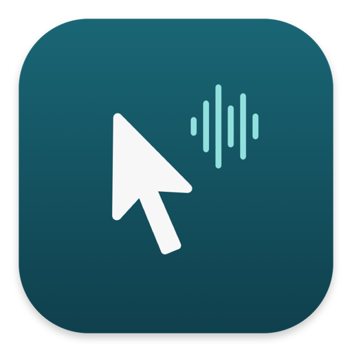
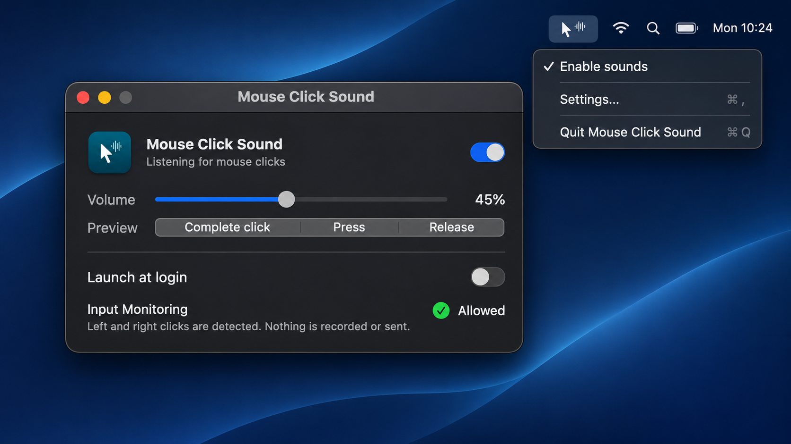

  

<h1 align="center">Mouse Click Sound</h1>

A small macOS menu-bar app for tactile mouse clicks, taps, holds, and drags. Requires macOS 14 or later.

  

## Install

Download and open the [latest DMG](https://github.com/aleksa-codes/mouse-click-sound/releases/latest/download/Mouse-Click-Sound-macOS.dmg), then drag the app to Applications. Because it is not notarized, Control-click the app and choose **Open** the first time. Allow it under System Settings → Privacy & Security → Input Monitoring, then reopen if macOS asks.

## Develop

Install Xcode Command Line Tools, then run `make run` to build and open the app. `make check` compiles the code and validates project metadata.

`make package` creates an ad-hoc-signed DMG and ZIP locally. It does not require a paid Apple Developer account. Users approve the first launch and Input Monitoring permission in macOS.

## License

MIT. See [LICENSE](LICENSE).
